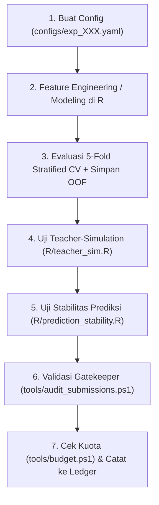

# AGENT.md — Panduan & SOP Agen AI untuk Pengelolaan Riset `KAGGLE_AUTO_WIN`

Dokumen ini adalah **Instruksi Operasional Standar (SOP)** bagi Agen AI (Antigravity, Claude, atau asisten agenik lainnya) yang bertugas mengelola, merancang eksperimen, memvalidasi model, dan mengotomasi pipeline pada repositori **`KAGGLE_AUTO_WIN`**.

---

## 1. Identitas & Batasan Proyek

- **Mata Kuliah:** Praktikum Sains Data (`STA1581`) — IPB University.
- **Studi Kasus:** Operator telekomunikasi seluler memprediksi pelanggan pra-bayar yang potensial (`Y = 1`) untuk diajak bertransaksi isi ulang melalui kanal perbankan (ATM, mobile/internet banking).
- **Dataset:** 
  - Train: `45.000` baris (`ID`, `X1` s.d. `X11`, `Y`).
  - Test: `5.000` baris (`ID` 45001 s.d. 50000, `X1` s.d. `X11`).
  - Proporsi Kelas Train: `Y = 0` (81,33%), `Y = 1` (18,67%, prior $\pi \approx 0.1867$).
- **Metrik Resmi Kaggle:** **Balanced Accuracy (BA)**
  $$\text{Balanced Accuracy} = \frac{1}{2}\left(\frac{\text{TP}}{\text{TP} + \text{FN}} + \frac{\text{TN}}{\text{TN} + \text{FP}}\right)$$
- **Bahasa Pemrograman Wajib:** **R** (menggunakan Rscript `C:\Program Files\R\R-4.6.1\bin\Rscript.exe`).
- **Aturan Output Tugas Kuliah:** 
  1. Repositori Kaggle + Prediksi Test.
  2. Sintaks program lengkap dalam format **HTML** (hasil kompilasi RMarkdown).
  3. Dokumen presentasi dalam format **PDF** (durasi presentasi 20 menit).
- **Aturan Kuota Submission:** Maksimal **5 kali submit per hari**. Reset setiap pukul **00:00 UTC (07:00 WIB)**. Batas akhir: **28 November 2026 pukul 23:59 WIB**.

---

## 2. Prinsip Ilmiah & Protokol Matematika/Statistika

Setiap tindakan pemodelan yang dilakukan oleh Agen AI WAJIB tunduk pada prinsip berikut:

### 2.1 Teorema Bayes-Optimal Thresholding
Untuk metrik Balanced Accuracy dengan model probabilistik $p(x) = P(Y=1 \mid X=x)$, aturan keputusan optimal bukanlah threshold default `0.50`, melainkan mendekati prior populasi:
$$t^* \approx \pi = P(Y=1) \approx 0.1867$$
- **Aturan Agen:** Jangan pernah mengevaluasi atau men-submit prediksi dengan threshold `0.50` secara membabi buta tanpa pembanding threshold optimal. Ambang batas `0.50` pada data timpang 18,67% akan menghancurkan *Sensitivity* (Recall) dan memotong skor Balanced Accuracy.

### 2.2 Fenomena Guru-Ensemble & Minimax Robustness
Penyelenggara mengonfirmasi bahwa label *ground truth* data uji dibangkitkan oleh **model ensemble**.
- **Karakteristik Label:** Halus (*smooth*), minim *label noise*, dan sangat dipengaruhi oleh arsitektur ensemble guru (apakah gurunya menggunakan threshold 0.50 atau balanced prior $\pi$).
- **Protokol Agen:** Sebelum merekomendasikan submission ke Kaggle, Agen WAJIB menjalankan simulasi pada `R/teacher_sim.R`. Model kandidat hanya boleh diajukan jika memiliki **Worst-Case Balanced Accuracy $\ge 0.74$** di hadapan seluruh variasi model Guru (*Random Forest, XGBoost, GLMnet, CART, dan Ensemble Average*).

### 2.3 Pencegahan Target Leakage (Jebakan `ID`)
- Pada data latih, urutan `ID 1`–`36598` adalah kelas `0` (`100%`) dan `ID 36599`–`45000` adalah kelas `1` (`100%`).
- Pada data uji, baris sudah diacak (*shuffled*).
- **Aturan Agen:** Kolom `ID` **HARUS SELALU DIHAPUS** dari matriks fitur sebelum pelatihan. Skema validasi lokal **HARUS SELALU MENGGUNAKAN Stratified K-Fold dengan pengacakan (*shuffled*)**.

---

## 3. Peta Navigasi Repositori

```text
KAGGLE_AUTO_WIN/
├── AGENT.md                                 # [DOKUMEN INI] SOP & pedoman kerja agen AI
├── README.md                                # Dokumentasi utama repositori
├── data/                                    # Dataset latih, uji, folds CV, & submission aktif
├── eda_script/                              # Skrip eksplorasi data, uji hipotesis, & render HTML
│   ├── 01_eda_comprehensive.R
│   ├── 01_eda_report.Rmd
│   └── 01_eda_report.html
├── feature_engineering_script/              # Skrip rekayasa fitur & output RDS/Parquet
├── modeling_script/                         # Skrip pemodelan individual & validasi gatekeeper
├── configs/                                 # [CONFIG-DRIVEN] Definisi eksperimen (YAML)
│   ├── exp_001_mvp_xgboost.yaml
│   └── exp_002_teacher_sim.yaml
├── R/                                       # [MODULAR LIBRARY] Fungsi R terstandarisasi
│   ├── metrics.R                            # Rumus metrik BA, sensitivitas, spesifisitas, Kappa
│   ├── teacher_sim.R                        # Simulasi validasi guru (10 variasi guru)
│   └── prediction_stability.R               # Matriks kesepakatan & stabilitas antar prediksi
├── ledger/                                  # [AUDIT TRAIL] Buku besar eksperimen & submission
│   ├── experiments.csv                      # Riwayat skor CV, SD, dan parameter model
│   └── submissions.csv                      # Riwayat hash SHA-256, tanggal, & skor publik
├── tools/                                   # [AUTOMATION UTILITIES] Skrip PowerShell
│   ├── audit_submissions.ps1                # Audit gatekeeper format, row count, & quote-cleaner
│   └── budget.ps1                           # Kalkulator sisa kuota submit & reset countdown
└── workflow/                                # [SPECIFICATIONS]
    ├── PRD.md                               # PRD pemodelan & kompetisi
    ├── PRD_SETUP_AUTOMATION.md              # PRD setup GitHub Actions & Kaggle API
    └── run_mvp_pipeline.R                   # Master pipeline runner lokal
```

---

## 4. Siklus Kerja Agen (Step-by-Step Workflow)

Ketika diminta merancang atau menguji eksperimen baru, Agen AI harus mengikuti 6 tahap berurutan:



### Tahap 1 — Definisi Konfigurasi
- Buat file baru pada `configs/exp_XXX_<nama>.yaml`. Tentukan arsitektur model, daftar fitur, hyperparameter, dan skema validasi.

### Tahap 2 — Eksekusi Model & Simpan Artefak
- Latih model menggunakan R.
- Wajib menghasilkan 3 file keluaran standar:
  1. `oof_predictions_exp_XXX.parquet` (prediksi Out-Of-Fold 45.000 baris).
  2. `test_probabilities_exp_XXX.parquet` (probabilitas test 5.000 baris).
  3. `submission_exp_XXX.csv` (file biner {0, 1} terformat ID,Y).

### Tahap 3 — Uji Teacher-Simulation
- Jalankan model baru terhadap kerangka simulasi guru:
  ```powershell
  & "C:\Program Files\R\R-4.6.1\bin\Rscript.exe" R/teacher_sim.R
  ```
- Catat *Worst-Case Balanced Accuracy* dan *Mean BA* di hadapan 10 variasi guru.

### Tahap 4 — Uji Stabilitas Antar-Prediksi
- Bandingkan file submission baru dengan baseline MVP (`submission_xgb_mvp.csv`):
  ```powershell
  & "C:\Program Files\R\R-4.6.1\bin\Rscript.exe" -e "source('R/prediction_stability.R'); compare_submissions(c('modeling_script/output/submission_xgb_mvp.csv', 'modeling_script/output/submission_exp_XXX.csv'))"
  ```
- Evaluasi nilai *Cohen's Kappa* ($\kappa$) dan persentase baris yang berubah.

### Tahap 5 — Pemeriksaan Gatekeeper Submission
- Jalankan audit sebelum menyentuh submission:
  ```powershell
  powershell -ExecutionPolicy Bypass -File tools/audit_submissions.ps1
  ```
- File WAJIB berstatus **PASS**, memiliki tepat 5.000 baris, tanpa karakter kutip tunggal (`'`), dan proporsi kelas positif antara 10% s.d. 45%.

### Tahap 6 — Cek Kuota & Catat ke Ledger
- Jalankan pengecekan kuota:
  ```powershell
  powershell -ExecutionPolicy Bypass -File tools/budget.ps1
  ```
- Tambahkan entri baru pada `ledger/experiments.csv` dan `ledger/submissions.csv` beserta *hash* SHA-256 lengkap.

---

## 5. Kebijakan Keamanan, Zero-Leakage, & Persetujuan Wajib Pengguna

1. **Jangan Pernah Menampilkan Token:** Dilarang mencetak, menulis, atau mengulang isi kunci API dari `kaggle.json` ke dalam respon percakapan, log, atau artefak publik.
2. **Proteksi Git:** Pastikan file kredensial (`.kaggle/`, `kaggle.json`, `.env`) tetap berada dalam `.gitignore`.
3. **Persetujuan Wajib Pengguna (Human-in-the-Loop Zero-Autonomous Submission):**
   - **DILARANG KERAS MEN-SUBMIT APAPUN KE KAGGLE TANPA PERSETUJUAN EKSPLISIT PENGGUNA.**
   - Tidak ada pengiriman otomatis oleh skrip, cron, background task, atau inisiatif mandiri agen.
   - Agen AI hanya menyiapkan berkas, mengaudit kualitasnya, dan melaporkan ringkasannya. Eksekusi pengiriman ke endpoint Kaggle HANYA boleh dipicu setelah pengguna memberikan persetujuan tegas (misal: *"submit"*, *"setuju"*, *"kirim"*, *"lanjutkan"*).

---

## 6. Referensi Perintah Cepat (Cheat-Sheet)

| Kebutuhan | Perintah Terminal (PowerShell) |
| :--- | :--- |
| **Menjalankan Pipeline MVP** | `& "C:\Program Files\R\R-4.6.1\bin\Rscript.exe" workflow/run_mvp_pipeline.R` |
| **Uji Teacher-Simulation** | `& "C:\Program Files\R\R-4.6.1\bin\Rscript.exe" R/teacher_sim.R` |
| **Uji Stabilitas Prediksi** | `& "C:\Program Files\R\R-4.6.1\bin\Rscript.exe" R/prediction_stability.R` |
| **Audit File Submission** | `powershell -ExecutionPolicy Bypass -File tools/audit_submissions.ps1` |
| **Cek Sisa Kuota Kaggle** | `powershell -ExecutionPolicy Bypass -File tools/budget.ps1` |
| **Render Laporan HTML** | `& "C:\Program Files\R\R-4.6.1\bin\Rscript.exe" -e "rmarkdown::render('eda_script/01_eda_report.Rmd')"` |
