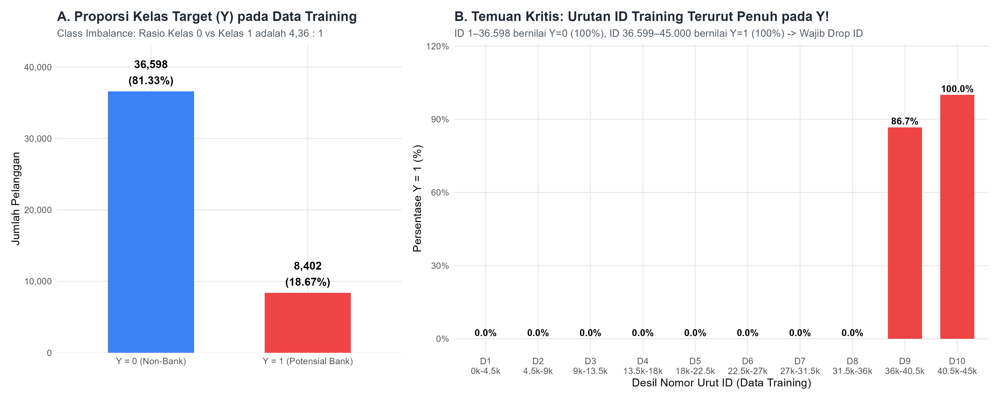
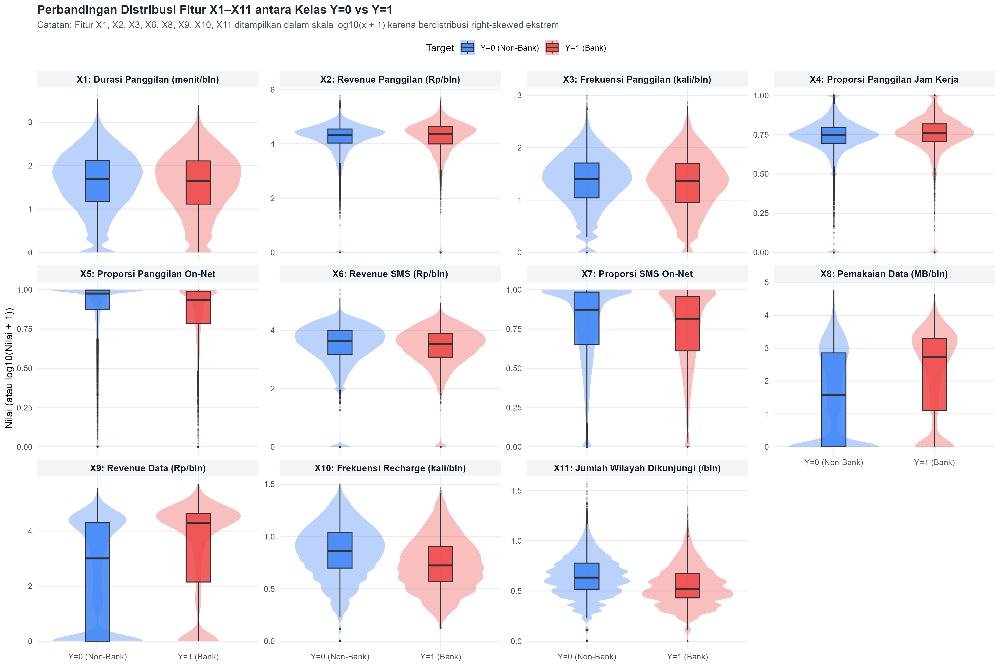
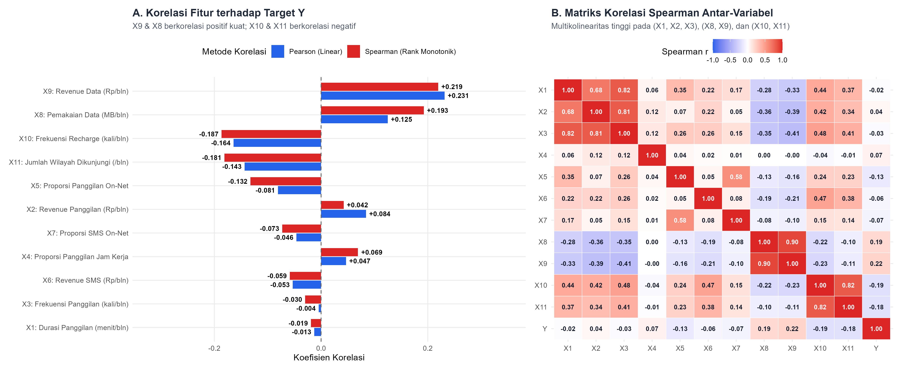
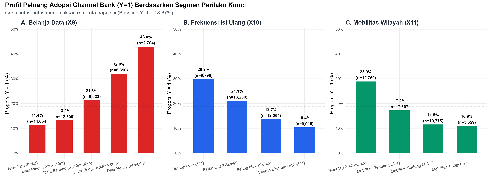
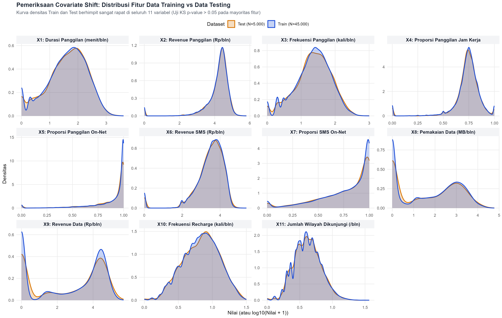
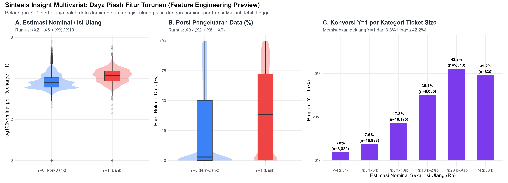

```{r setup, include=FALSE}
knitr::opts_chunk$set(
  echo = TRUE,
  warning = FALSE,
  message = FALSE,
  fig.width = 12,
  fig.height = 6,
  dpi = 300
)
library(tidyverse)
library(patchwork)
library(scales)
library(knitr)
library(nanoparquet)
```

# Pendahuluan & Konteks Bisnis

Sebuah operator telekomunikasi seluler bekerja sama dengan pihak bank untuk meningkatkan angka isi ulang pulsa (*recharge*) pelanggan pra-bayar melalui **channel perbankan** (ATM, *mobile banking*, *internet banking*, dsb.). Tujuan dari analisis ini adalah membangun pemahaman mendalam terhadap perilaku **45.000 pelanggan** pada data *training* dan **5.000 pelanggan** pada data *testing* guna merancang strategi *preprocessing*, *feature engineering*, dan pemodelan yang mengoptimalkan metrik evaluasi **Balanced Accuracy**.

# Memuat Data & Pemeriksaan Struktur

```{r load-data}
train_df <- as.data.frame(read_parquet("../data/training_data_tugas_praktikum_DataScience.parquet"))
test_df  <- as.data.frame(read_parquet("../data/testing_data_tugas_praktikum_DataScience.parquet"))

cat("Dimensi Train:", dim(train_df), "\n")
cat("Dimensi Test :", dim(test_df), "\n")
cat("Total NA Train / Test:", sum(is.na(train_df)), "/", sum(is.na(test_df)), "\n")
```

# Temuan Kritis #1: Class Imbalance & Target Leakage pada `ID`

Pemeriksaan distribusi kelas target `Y` dan hubungannya dengan nomor urut `ID` mengungkap struktur yang sangat krusial:

* **Class Imbalance (81,33% vs 18,67%):** Kelas `Y = 0` berjumlah **36.598 pelanggan (81,33%)**, sedangkan kelas `Y = 1` berjumlah **8.402 pelanggan (18,67%)**.
* **Data Training Terurut Penuh Berdasarkan `Y`:** Baris `ID 1` hingga `36598` semuanya bernilai `Y = 0`, sedangkan baris `ID 36599` hingga `45000` semuanya bernilai `Y = 1`. Sebaliknya, data *testing* (`ID 45001–50000`) sudah diacak (*shuffled*).
* **Tindakan Wajib:** Kolom `ID` **wajib dibuang** dari fitur prediktor, dan pembagian validasi lokal **wajib menggunakan *Stratified K-Fold Cross-Validation* dengan pengacakan (*shuffling*)**.

```{r plot-fig01, echo=FALSE, out.width="100%"}

```

# Statistik Deskriptif & Uji Hipotesis Antar-Kelas (`Y = 0` vs `Y = 1`)

Berikut adalah perbandingan rata-rata, median, korelasi *Pearson*, korelasi *Spearman*, serta statistik uji *Kolmogorov-Smirnov (KS)* baik antara kelas `Y = 0` vs `Y = 1` maupun antara *Train* vs *Test*:

```{r table-stats}
stats_tbl <- as.data.frame(read_parquet("output/02_class_comparison_and_stat_tests.parquet"))
kable(stats_tbl, caption = "Perbandingan Statistik Kelas Y=0 vs Y=1 dan Uji Kestabilan Train-Test")
```

```{r plot-fig02, echo=FALSE, out.width="100%"}

```

# Analisis Korelasi & Multikolinearitas

1. **Fitur Paling Berpengaruh Positif:** `X9` (*Revenue* Data, $r = +0.2314$, $\rho = +0.2494$) dan `X8` (Pemakaian Data MB, $r = +0.1248$, $\rho = +0.2356$).
2. **Fitur Paling Berpengaruh Negatif:** `X10` (Frekuensi *Recharge*, $r = -0.1642$, $\rho = -0.2143$) dan `X11` (Jumlah Wilayah Dikunjungi, $r = -0.1433$, $\rho = -0.1931$).
3. **Multikolinearitas Kuat:**
   * Kelompok Panggilan Suara (`X1`, `X2`, `X3`) memiliki korelasi *Spearman* $\rho \in [0.80, 0.90]$.
   * Kelompok Internet Data (`X8`, `X9`) memiliki korelasi *Spearman* $\rho = 0.96$.

```{r plot-fig03, echo=FALSE, out.width="100%"}

```

# Analisis Zero-Inflation, Anomali Pembulatan & Segmen Perilaku

```{r table-anomalies}
anom_tbl <- as.data.frame(read_parquet("output/03_zero_inflation_and_anomalies.parquet"))
kable(anom_tbl, caption = "Audit Segmen Khusus, Zero-Inflation, dan Anomali Pembulatan")
```

```{r plot-fig04, echo=FALSE, out.width="100%"}

```

# Pemeriksaan Covariate Shift (Train vs Test)

Seluruh 11 fitur (`X1`–`X11`) memiliki distribusi yang identik antara data *training* dan data *testing* (nilai statistik *KS Train-Test* berkisar `0.004`–`0.015`), yang memastikan bahwa skema *Stratified Cross-Validation* pada data *training* akan sangat representatif terhadap skor di *Leaderboard* Kaggle.

```{r plot-fig05, echo=FALSE, out.width="100%"}

```

# Sintesis Insight untuk Tahap Feature Engineering & Modeling

Kombinasi antara total pengeluaran bulanan (`Total_Spend = X2 + X6 + X9`) dan frekuensi isi ulang (`X10`) melahirkan fitur kunci **Estimasi Nominal per Sekali Isi Ulang (*Estimated Recharge Ticket Size*)**, yang mampu memisahkan peluang adopsi *channel* bank dari **5,4%** (pada nominal isi ulang kecil $\le\text{Rp3.000}$) hingga **>42%** (pada nominal isi ulang besar $>\text{Rp50.000}$).

```{r plot-fig06, echo=FALSE, out.width="100%"}

```
