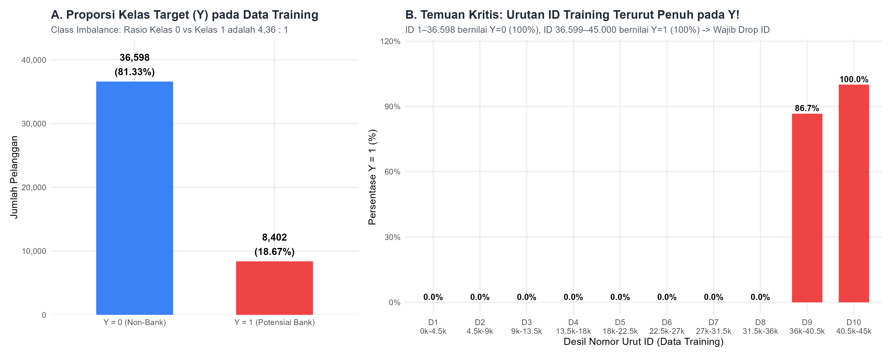
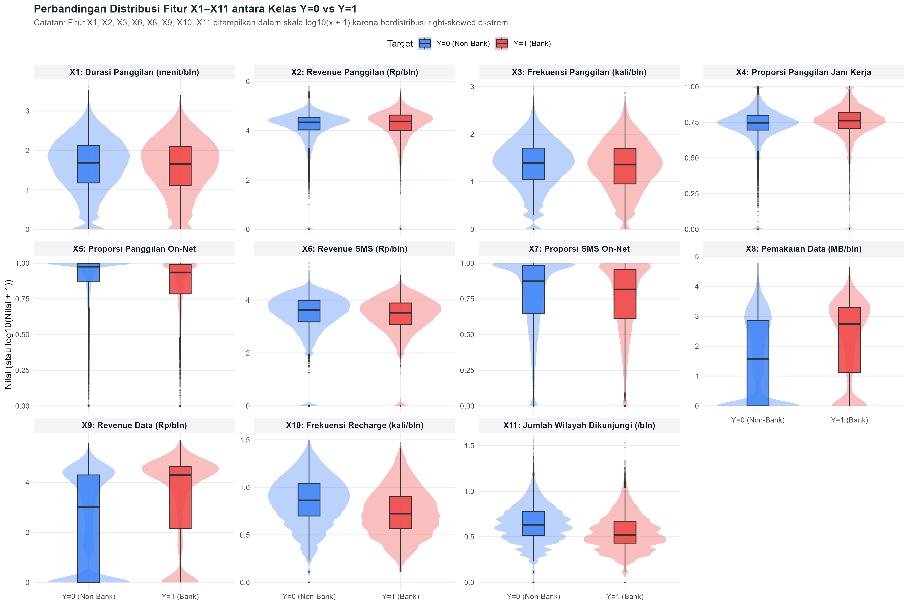
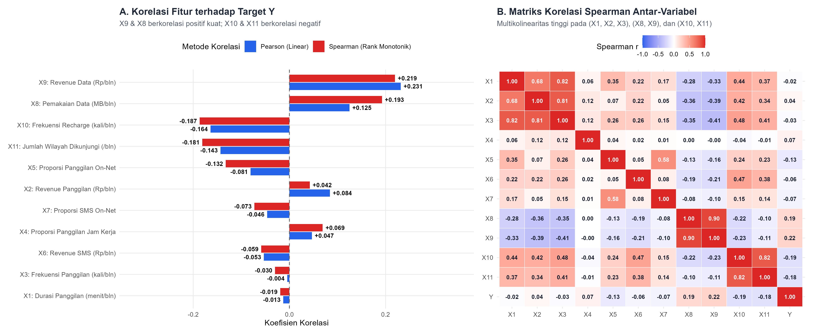
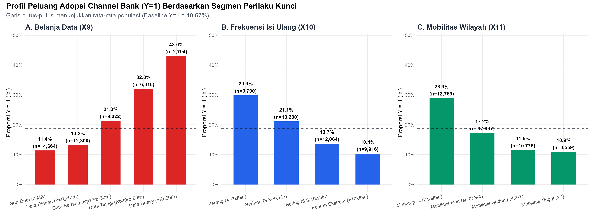
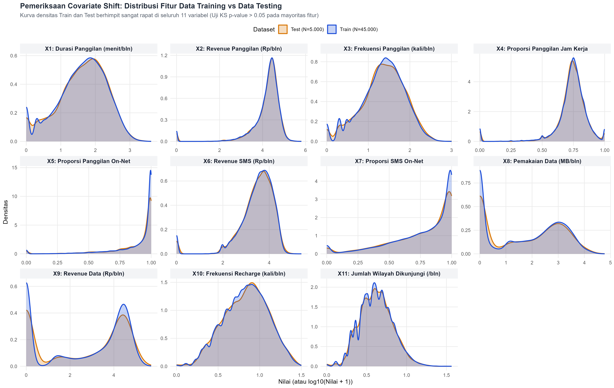
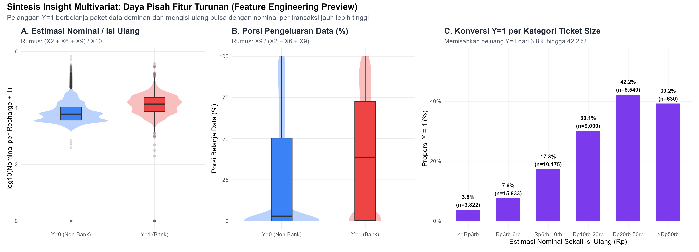

# Exploratory Data Analysis (EDA) — KAGGLE_AUTO_WIN

Folder ini berisi skrip R, laporan analisis interaktif (`.html` & `.Rmd`), tabel ringkasan statistik (`.parquet`), serta visualisasi beresolusi tinggi (`.png`) untuk tahap **Exploratory Data Analysis (EDA)** sesuai alur kerja pada [`workflow/workflow.png`](../workflow/workflow.png).

---

## Struktur File di `eda_script/`

```text
eda_script/
├── 01_eda_mvp.R                                     # Skrip EDA cepat berbasis data.table + nanoparquet
├── 01_eda_comprehensive.R                           # Skrip utama R untuk menjalankan seluruh pipeline EDA mendalam + HTML
├── 01_eda_report.Rmd                                # File RMarkdown dokumentasi & narasi EDA
├── 01_eda_report.html                               # Output laporan HTML standalone (lengkap penjelasan sintaks & plot)
├── README.md                                        # Dokumentasi ringkasan temuan EDA (file ini)
├── output/
│   ├── 01_summary_statistics_train_test.parquet     # Statistik deskriptif lengkap (Mean, SD, Quartiles, IQR, Skewness)
│   ├── 02_class_comparison_and_stat_tests.parquet   # Perbandingan Y=0 vs Y=1, korelasi Pearson/Spearman, uji Wilcoxon & KS
│   ├── 03_zero_inflation_and_anomalies.parquet      # Audit segmen zero-inflated & anomali pembulatan
│   ├── 04_spearman_correlation_matrix.parquet       # Matriks korelasi peringkat Spearman (X1–X11 & Y)
│   ├── eda_class_balance.parquet                    # Ringkasan proporsi kelas Y (output 01_eda_mvp.R)
│   ├── eda_feature_summary.parquet                  # Ringkasan fitur & rasio kelas (output 01_eda_mvp.R)
│   └── eda_anomalies_report.parquet                 # Ringkasan audit anomali 3-bulanan (output 01_eda_mvp.R)
└── plots/
    ├── fig01_target_distribution_and_id_leakage.png # Proporsi kelas Y & bukti urutan ID (Target Leakage)
    ├── fig02_feature_distributions_by_class.png     # Violin + Boxplot distribusi X1–X11 per kelas Y
    ├── fig03_correlation_and_feature_associations.png # Barplot korelasi terhadap Y & Heatmap korelasi Spearman
    ├── fig04_zero_inflation_and_segment_conversion.png # Peluang adopsi bank (Y=1) per segmen perilaku kunci
    ├── fig05_train_vs_test_distribution_check.png   # Evaluasi Covariate Shift (Density Train vs Test)
    └── fig06_multivariate_arpu_vs_recharge.png      # Preview daya pisah fitur turunan (Ticket Size & Data Share)
```

---

## Ringkasan Eksekutif Temuan EDA

### 1. Kualitas Data, Class Imbalance & Jebakan `ID` (*Target Leakage*)
* **Kelengkapan Data:** Tidak terdapat *missing values* (`NA = 0`) baik pada data *training* (`45.000` baris) maupun data *testing* (`5.000` baris). Hanya terdapat `4` baris duplikat fitur identik di data *training*.
* **Class Imbalance (`4,36 : 1`):**
  * Kelas `Y = 0` (*Non-Bank*): **36.598 pelanggan (81,33%)**
  * Kelas `Y = 1` (*Potensial Channel Bank*): **8.402 pelanggan (18,67%)**
* **Temuan Kritis — Pengurutan `ID` pada Data Training:**
  * Pada data *training*, baris `ID 1` s.d. `36598` seluruhnya adalah kelas `Y = 0` (`100%`), sedangkan baris `ID 36599` s.d. `45000` seluruhnya adalah kelas `Y = 1` (`100%`).
  * Sebaliknya, pada data *testing* (`ID 45001` s.d. `50000`), urutan baris **sudah diacak (*shuffled*)**.
  * **Keputusan Pipeline:** Kolom `ID` **wajib dihapus** sebelum pelatihan model, dan skema validasi lokal **wajib menggunakan *Stratified K-Fold Cross-Validation* dengan pengacakan (*shuffling*)**.



---

### 2. Perbandingan Statistik Kelas (`Y = 0` vs `Y = 1`) & Daya Pisah Fitur

Seluruh 11 variabel prediktor memiliki perbedaan distribusi yang signifikan secara statistik antara kelas `Y = 0` dan `Y = 1` berdasarkan uji non-parametrik *Wilcoxon Rank-Sum* dan *Kolmogorov-Smirnov (KS)*:

| Peringkat | Variabel | Deskripsi | Median `Y=0` | Median `Y=1` | Mean `Y=0` | Mean `Y=1` | Korelasi Pearson ($r$) | Korelasi Spearman ($\rho$) | Statistik KS Kelas |
| :---: | :---: | :--- | ---: | ---: | ---: | ---: | ---: | ---: | ---: |
| **1** | **`X9`** | Revenue Data (Rp/bln) | `1.010` | **`20.000`** | `13.208,1` | `29.094,4` | **`+0,2314`** | **`+0,2194`** | `0,2606` |
| **2** | **`X8`** | Pemakaian Data (MB/bln) | `37` | **`543`** | `813,8` | `1.537,6` | `+0,1248` | **`+0,1926`** | `0,2259` |
| **3** | **`X10`** | Frekuensi Recharge (kali/bln) | `6,3` | **`4,3`** | `7,50` | `5,47` | **`-0,1642`** | **`-0,1866`** | `0,2118` |
| **4** | **`X11`** | Wilayah Dikunjungi (/bln) | `3,3` | **`2,3`** | `3,85` | `2,96` | **`-0,1433`** | **`-0,1812`** | `0,2066` |
| **5** | **`X5`** | Proporsi Panggilan On-Net | `0,976` | `0,935` | `0,891` | `0,850` | `-0,0807` | `-0,1323` | `0,1551` |
| **6** | **`X7`** | Proporsi SMS On-Net | `0,873` | `0,816` | `0,778` | `0,748` | `-0,0463` | `-0,0728` | `0,0963` |
| **7** | **`X4`** | Proporsi Panggilan Jam Kerja | `0,748` | `0,762` | `0,731` | `0,748` | `+0,0467` | `+0,0691` | `0,0918` |
| **8** | **`X6`** | Revenue SMS (Rp/bln) | `4.156` | `3.324,5` | `6.947,7` | `5.868,6` | `-0,0532` | `-0,0586` | `0,0714` |
| **9** | **`X2`** | Revenue Panggilan (Rp/bln) | `21.737` | `23.730` | `26.780,8` | `32.679,2` | `+0,0842` | `+0,0423` | `0,0865` |
| **10** | **`X3`** | Frekuensi Panggilan (kali/bln) | `24` | `22` | `40,21` | `39,64` | `-0,0044` | `-0,0298` | `0,0463` |
| **11** | **`X1`** | Durasi Panggilan (menit/bln) | `48` | `44` | `111,82` | `105,87` | `-0,0128` | `-0,0190` | `0,0274` |



---

### 3. Struktur Korelasi & Multikolinearitas

* **Tiga Klaster Multikolinearitas Utama:**
  1. **Klaster Panggilan Suara (`X1`, `X2`, `X3`):** Korelasi *Spearman* $\rho \in [0,68; 0,82]$.
  2. **Klaster Internet Data (`X8`, `X9`):** Korelasi *Spearman* $\rho = 0,9004$.
  3. **Klaster Isi Ulang & Mobilitas (`X10`, `X11`):** Korelasi *Spearman* $\rho = 0,8172$.
* **Paradoks Panggilan Suara (`X1` & `X3` vs `X2` & `X5`):** Durasi (`X1`) dan frekuensi panggilan (`X3`) berkorelasi sedikit negatif dengan `Y`, tetapi pengeluaran uang panggilan (`X2`) berkorelasi positif (`r = +0,0842`). Hal ini terjadi karena pelanggan `Y = 1` memiliki proporsi panggilan lintas operator (*off-net*, `1 - X5`) yang lebih tinggi dengan tarif per menit yang jauh lebih mahal.



---

### 4. Audit Segmen Khusus, *Zero-Inflation*, & Pola Pembulatan 3 Bulan

1. **Segmen *Non-Data Users* (`X8 = 0 & X9 = 0`):** Mencakup **32,59%** data *training* (`14.664` pelanggan) dan **34,08%** data *testing* (`1.704` pelanggan). Peluang adopsi *channel* bank pada segmen ini hanya **11,39%**, berbanding **22,19%** pada pengguna data aktif (hampir 2x lipat).
2. **Pola Desimal `.0`, `.3`, `.7` pada `X10` dan `X11`:** Mengungkap bahwa seluruh variabel bulanan dihitung dari rata-rata **periode pengamatan 3 bulan** (`Total_3_Bulan / 3`), di mana `X10` dan `X11` dibulatkan ke 1 angka desimal sedangkan `X1, X2, X3, X6, X8, X9` dibulatkan ke bilangan bulat terdekat.
3. **Anomali Pembulatan & Pengodean Nol:**
   * `1.022` baris di *train* (`113` di *test*) memiliki `X1 = 0` tetapi `X3 > 0` (akibat rata-rata durasi panggilan $< 0,5$ menit/bulan dibulatkan ke `0`), dengan tingkat konversi `Y = 1` cukup tinggi (`21,23%`).
   * `175` baris di *train* (`15` di *test*) tidak melakukan panggilan (`X3 = 0`) namun tercatat memiliki proporsi `X4 = 1` dan `X5 = 1` (`20,57%` bernilai `Y = 1`).
   * `144` baris di *train* (`20` di *test*) memakai kuota data (`X8 > 0`) tetapi `X9 = 0` (pengguna paket *bundling*/bonus data), dengan tingkat konversi tinggi (`27,08%`).



---

### 5. Evaluasi *Covariate Shift* (Kestabilan Distribusi Train vs Test)

Perbandingan kepadatan distribusi (*density overlay*) dan uji *Kolmogorov-Smirnov* dua sampel antara `Train` (`N = 45.000`) dan `Test` (`N = 5.000`) menunjukkan nilai statistik *KS* yang sangat kecil di seluruh variabel (`0,0069` s.d. `0,0210`). Artinya, data *training* dan *testing* berasal dari populasi yang sama (**tidak ada *covariate shift***).



---

### 6. Rekomendasi untuk Tahap *Feature Engineering* & *Modeling*

Berdasarkan temuan EDA di atas, fitur turunan yang wajib dibangun pada [`feature_engineering_script/`](../feature_engineering_script/) meliputi:
1. **Total Belanja Bulanan (*ARPU*):** `Total_Spend = X2 + X6 + X9`.
2. **Estimasi Nominal per Sekali Isi Ulang (*Recharge Ticket Size*):** `Total_Spend / pmax(X10, 0.3333)` — terbukti memisahkan peluang `Y = 1` dari **3,8%** (nominal $\le\text{Rp3.000}$) hingga **42,2%** (nominal $\text{Rp20.000–Rp50.000}$).
3. **Komposisi Dompet (*Wallet Share*):** Proporsi pengeluaran Data (`X9 / Total_Spend`), Suara (`X2 / Total_Spend`), dan SMS (`X6 / Total_Spend`).
4. **Tarif Efektif & Intensitas:** Biaya per menit telepon (`X2 / (X1 + 1)`), biaya per panggilan (`X2 / (X3 + 1)`), durasi per panggilan (`X1 / (X3 + 1)`), dan biaya data per MB (`X9 / (X8 + 1)`).
5. **Aktivitas *Off-Net* & Luar Jam Kerja:** Durasi dan biaya telepon lintas operator (`X1 * (1 - X5)`, `X2 * (1 - X5)`), biaya SMS lintas operator (`X6 * (1 - X7)`), serta durasi telepon jam kerja (`X1 * X4`).
6. **Indikator Biner (*Flags*) & Rekonstruksi 3 Bulan:** Flag *Non-Data User* (`X8 == 0 & X9 == 0`), flag *Free Data* (`X8 > 0 & X9 == 0`), flag anomali pembulatan (`X1 == 0 & X3 > 0` dan `X3 == 0 & X4 == 1`), serta total isi ulang & wilayah selama 3 bulan (`round(X10 * 3)` dan `round(X11 * 3)`).



---

## Cara Menjalankan Skrip EDA

Dari *root directory* proyek (`KAGGLE_AUTO_WIN`), jalankan perintah berikut di terminal:

```powershell
& "C:\Program Files\R\R-4.6.1\bin\Rscript.exe" eda_script/01_eda_comprehensive.R
```
